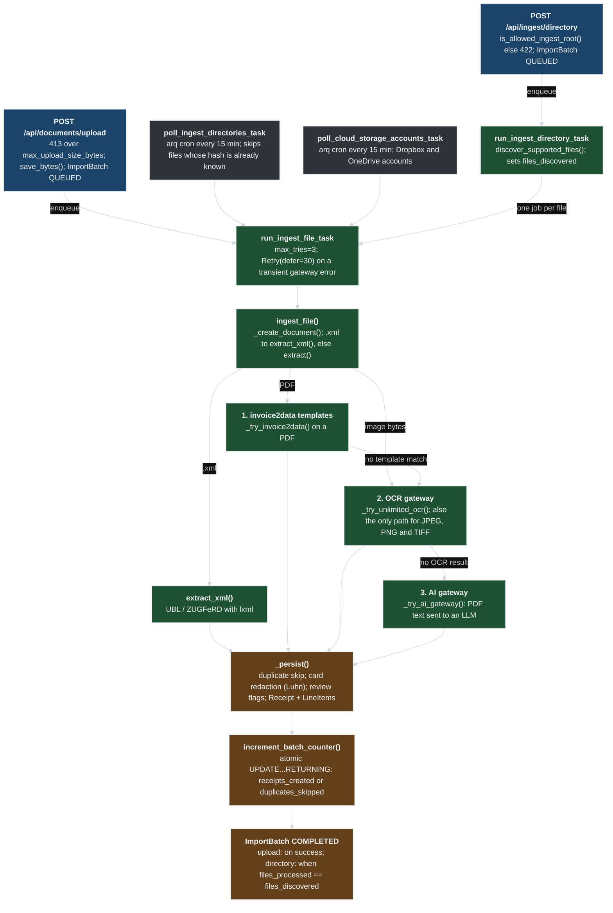

# Ingestion pipeline

How a document gets from an upload, a directory, a scheduled poll or a cloud-storage account to a persisted Receipt. Names are taken from app/api/routes.py, app/tasks.py, app/services/ingestor.py and app/services/extractor.py.

Download: [SVG](ingestion-pipeline.svg) · [Excalidraw](ingestion-pipeline.excalidraw) · [Mermaid source](ingestion-pipeline.mmd) · [Interactive HTML](ingestion-pipeline.html) (docs site)

| Colour | Meaning |
|---|---|
| blue | Entry point or request handler |
| green | Worker task or pipeline step |
| gray | Scheduled trigger |
| orange | Persistence and batch state |

| Node | Detail |
|---|---|
| `POST /api/ingest/directory` | is_allowed_ingest_root() else 422; ImportBatch QUEUED |
| `POST /api/documents/upload` | 413 over max_upload_size_bytes; save_bytes(); ImportBatch QUEUED |
| `poll_ingest_directories_task` | arq cron every 15 min; skips files whose hash is already known |
| `poll_cloud_storage_accounts_task` | arq cron every 15 min; Dropbox and OneDrive accounts |
| `run_ingest_directory_task` | discover_supported_files(); sets files_discovered |
| `run_ingest_file_task` | max_tries=3; Retry(defer=30) on a transient gateway error |
| `ingest_file()` | _create_document(); .xml to extract_xml(), else extract() |
| `extract_xml()` | UBL / ZUGFeRD with lxml |
| `1. invoice2data templates` | _try_invoice2data() on a PDF |
| `2. OCR gateway` | _try_unlimited_ocr(); also the only path for JPEG, PNG and TIFF |
| `3. AI gateway` | _try_ai_gateway(): PDF text sent to an LLM |
| `_persist()` | duplicate skip; card redaction (Luhn); review flags; Receipt + LineItems |
| `increment_batch_counter()` | atomic UPDATE...RETURNING: receipts_created or duplicates_skipped |
| `ImportBatch COMPLETED` | upload: on success; directory: when files_processed == files_discovered |

**Waterfall order**

- XML first, then invoice2data templates, then the OCR gateway, then the AI gateway
- Deterministic paths always win before any AI call

**Failure handling**

- A transient gateway error retries the job after 30 s, up to 3 tries
- In a directory batch one bad file is counted in receipts_failed and does not stop the others

[All diagrams](index.md)
